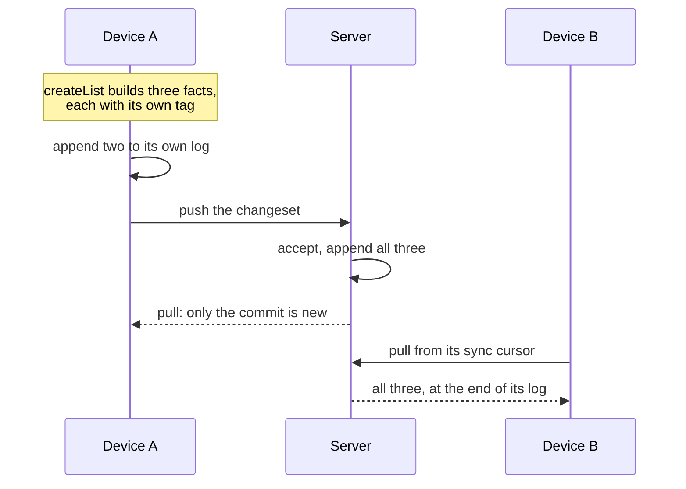
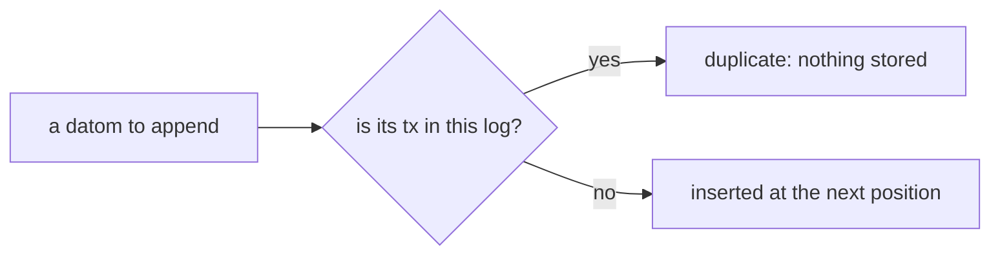

import DatomLog from '../../../../../components/DatomLog.astro'
import Exercise from '../../../../../components/Exercise.astro'
import PointAt from '../../../../../components/PointAt.astro'
import ReadNext from '../../../../../components/ReadNext.astro'
import Sample from '../../../../../components/Sample.astro'
import StepLine from '../../../../../components/StepLine.astro'
import Term from '../../../../../components/Term.astro'
import Terms from '../../../../../components/Terms.astro'
import WhoHoldsTheLog from '../../../../../partials/log-store/who-holds-the-log.mdx'

## Recall first

This is the first lesson, so the questions are on
[Before you start](/guides/before-you-start/). Answer before you open them.

In `Effect.Effect<A, E, R>`, what do the three letters stand for?

What it succeeds with (`A`), what it can fail with (`E`), and what it needs to
run (`R`).

Inside `Effect.gen`, what does `yield* store.mint()` do?

It runs `store.mint()` and gives you its result, a `tx`, the way `await` does;
if minting fails, the rest is skipped.

## The idea

**Everything an organization knows is small facts in a log that is only ever
added to. Every device holds a copy, and so does the server, which has the
last word. Each fact carries a tag it got once, so no copy stores the same
fact twice.**

Here is a new list on its way, as a person using the evidence app creates it
on device A. The widget below lets you do it yourself.

Nobody changes or removes a fact that is in a log; a device adds what it pulls
at the end of its own.

### Try it

<DatomLog />

What is simplified: tags are shown by their last four characters, where a real
`tx` has 26; a row shows an attribute by its last part (`title` for
`evidence/list/title`), leaves out `e` when the logs are side by side, and the
panel above the logs shows the whole fact; the commit's value is cut short; the positions count without
gaps, where a real store may skip numbers; there is one list; nobody signs in, and the server
takes every change, where the real one first checks it (the changesets guide).
A test plays the widget's scenarios on the real sync server, composed as the
evidence server runs it, and two real devices, and checks that every log holds
the same facts in the same order (`apps/docs/src/lib/datom-log.integration.test.ts`).

### What you saw

1. **Creating a list says it exists, once; a rename adds only a title.** Every
   title stays in every log; which one counts is lesson 2. A rename never says
   again that the list exists: that would bring back a list another device had
   deleted. <PointAt part="datom">Show a fact</PointAt>
2. **Each copy is a log of its own,** and a device can rename only a list it
   has pulled. <PointAt part="server">Show the server</PointAt>
   <PointAt part="device">Show the devices</PointAt>
3. **Taking turns needs no lock.** A, then B, then A again are plain appends.
4. **Each fact has a tag, made once, when the fact is built,** and every log
   keeps each tag once. So sending a changeset again is harmless, if it is the
   same one. Give it new tags and no log can tell: it is stored a second time.
   <PointAt part="tx">Show the tags</PointAt>
5. **Where a fact sits is each log's own.** The same fact has one tag
   everywhere and another position in each log. <PointAt part="position">Show the positions</PointAt>

### Who holds the log

<WhoHoldsTheLog />

### The words

Now the names for what you saw. Each card is the word's glossary entry, with
one line for what it does or where it appears. "Show it in the widget" points
at it.

**What is stored**

<Terms>
  <Term term="Datom" label="Appears in" formula={"append: (log, «datom») => (log', inserted | duplicate)\n«datom» = [e, a, v, tx, op, cs]"} point="datom" later={['HLC (lesson 2)']} />
  <Term term="Entity" label="Appears in" formula="datom = [«e», a, v, tx, op, cs]" point="entity" later={['workflow run (another guide)']} />
  <Term term="Attribute" label="Appears in" formula="datom = [e, «a», v, tx, op, cs]" point="attribute" later={['catalog', 'conflict policy (lesson 2)']} />
  <Term term="tx" label="Made by, and checked by" formula={"mint:   () => «tx»\nappend: a datom whose «tx» the log has => duplicate"} point="tx" later={['HLC (lesson 2)']} />
  <Term term="op" label="Appears in" formula={"datom = [e, a, v, tx, «op», cs]\n«op» = 'assert' | 'retract'"} point="op" later={['defining attribute']} />
  <Term term="Log store" label="Its operations" formula={"mint:       () => tx\n«append»:     (log, datom) => (log', inserted | duplicate)\nstreamFrom: (log, position) => the datoms after it"} point="logstore" later={['journal', 'read model']} />
  <Term term="Log position" label="Given by, and used by" formula={"append:     gives the datom the next «position»\nstreamFrom: (log, «position») => the datoms after it"} point="position" />
</Terms>

**Who holds it**

<Terms>
  <Term term="Sync node" label="Is one of" formula={"«sync node» = device | server\neach keeps its own copy of the log"} point="syncnode" later={['changeset (changesets guide)', 'replica']} />
  <Term term="Device" label="Its operations" formula={"write: append(its own log, the facts but the commit), queue the changeset\nsync:  push(its outbox) to the server, then pull(the facts after its sync cursor)"} point="device" later={['local replica', 'provider account']} />
  <Term term="Server" label="Its operations" formula={"accept: (changeset) => append(its log, every fact) | stores nothing if it has every tx\npull:   (sync cursor) => the facts after it"} point="server" />
  <Term term="Authority" label="Held by" formula={"«authority» = accept or reject each change, order the accepted ones, ...\nheld today by: the server"} point="authority" later={['membership', 'conflict policy (lesson 2)', 'workflow run (another guide)']} />
  <Term term="Consumer" label="Appears in" formula={"pull:        (server log, the «consumer»'s cursor) => the facts after it\nacknowledge: («consumer», cursor) => how far it has delivered"} point="consumer" later={['acknowledged cursor (lesson 3)', 'trace sink']} />
</Terms>

### One line for the step

Appending is the one thing that happened in the widget, on every log, over
and over. This line says all of it: take a log and a datom, give back the log,
and whether the datom was inserted or was a duplicate.

<StepLine name="append" formula="append: (log, datom) => (log', inserted | duplicate)" />

The widget's model is that line as a function:

<Sample path="apps/docs/src/lib/datom-log.ts" region="append" />

The log store's contract has it as `append`, beside `mint` and `streamFrom`
([idea 1](/guides/before-you-start/#1-the-effect-type), [idea 6](/guides/before-you-start/#6-services)).
What the line leaves out: the real `append` takes several datoms at once and
answers with two counts; it takes an envelope, who wrote on which device; and
it can fail, in the `E` slot. It is the same contract on a device and on the
server.

<Sample path="libs/datom/src/log-store.ts" region="service" />

### In the code

**What builds the facts.** A command works out the change and gives back its
facts, storing nothing: `createList` the three you saw first,
`renameList` a title and its commit. `finish` adds the commit that closes the
changeset. The tags in `mint` were minted before the command ran. Effect here:
`Effect.Effect` ([idea 1](/guides/before-you-start/#1-the-effect-type)),
`Effect.fail` ([idea 5](/guides/before-you-start/#5-errors-with-a-name)).

<Sample path="features/evidence/model/src/command.ts" region="createList" />

<Sample path="features/evidence/model/src/command.ts" region="renameList" />

**What a device does when it writes.** Every fact but the commit goes into its
own log, and the changeset into its outbox; the commit comes back once the
server has accepted it. Effect here: `yield*`
([idea 2](/guides/before-you-start/#2-steps-in-order)).

<Sample path="libs/sync/client/src/client.ts" region="write" />

**What the server does with a changeset it has seen.** If it holds every tag
already, it stores nothing and answers as if it had; that is why sending again
is harmless. Half seen is refused: a changeset is stored whole or not at all.
Effect here: `yield*` ([idea 2](/guides/before-you-start/#2-steps-in-order)),
an error with a name ([idea 5](/guides/before-you-start/#5-errors-with-a-name)).

<Sample path="libs/sync/server/src/server.ts" region="resend" />

No screen in the evidence app creates or renames a list yet; the commands are
called by the evidence server's tests and by the runtime the identity gate
drives.

## What the gate showed

[P04 Log store conformance][P04] ran append and duplicate append on sqlite-node, PGlite, the
iOS simulator, the Android emulator and web: appending a datom whose `tx` was
already stored was a no-op, while a new `tx` was appended. That pair is the
gate's positive control, so the check can tell a store that dedups from one
that does not. [P09 Sync][P09] ran two devices against the server on sqlite-node: a
rename written offline stayed on device A until A pushed, then device B's
pull showed it; a second append of the same `tx` was acknowledged and stored
nothing.

## Your turn

Exercise 01.01: `sendTwice` sends three facts, then sends them again as a
retry would. It has the bug of the red button: the second send stores three
new facts. Effect here: a service ([idea 6](/guides/before-you-start/#6-services))
and steps in order ([idea 2](/guides/before-you-start/#2-steps-in-order)).

<Exercise pattern="log-store" id="01.01" />

## Check yourself

Why does minting a tx inside the retry loop duplicate facts?

Each attempt gets a new `tx`, so each is a new fact to every log.

Device B has a fact that the server also has. Which part is equal in both?

Its `tx` is equal; its position is each log's own and may differ.

Which copy of the log is kept for good, and why that one?

The server's: it holds authority, so its log is the accepted order.

## Read next

<ReadNext source={frontmatter.source} />

{/* References: written by pnpm refs fix; do not edit by hand. */}

[P04]: ../../../../../../../../docs/plan/bootstrap/06-qualification-gates.md#p04
[P09]: ../../../../../../../../docs/plan/bootstrap/06-qualification-gates.md#p09
