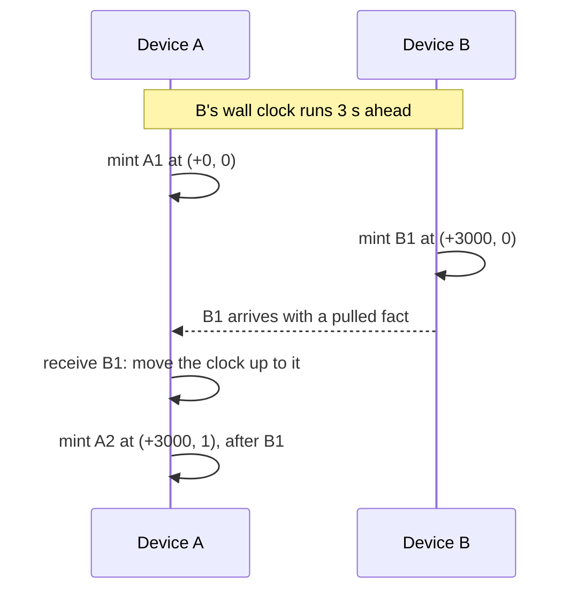
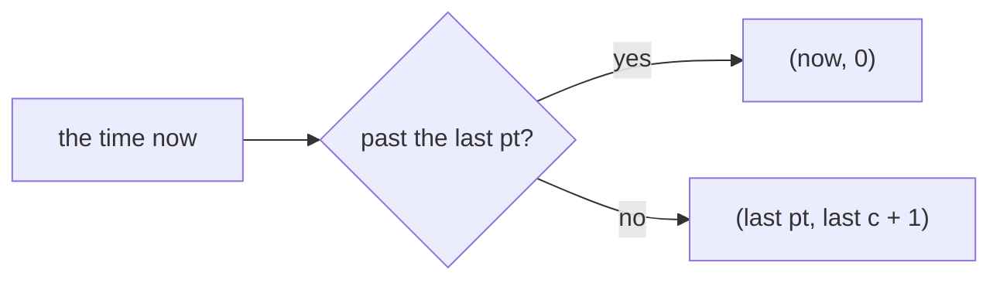

import ClockWidget from '../../../../../components/ClockWidget.astro'
import Exercise from '../../../../../components/Exercise.astro'
import ReadNext from '../../../../../components/ReadNext.astro'
import Sample from '../../../../../components/Sample.astro'
import Term from '../../../../../components/Term.astro'
import Terms from '../../../../../components/Terms.astro'
import Clock from '../../../../../partials/log-store/clock.mdx'

## Recall first

Why is resending a datom safe?

It carries the same `tx`, and the store keeps each `tx` once.

What does a log position tell you, and what does it not?

The fact's place in this copy only; not what the fact is, nor where another
copy has it.

## The idea

**Every tag says when, in an order no device can break: not the wall clock's
time, which lies, but a clock that only moves forward and takes in what other
devices have seen.**

A wall clock is set by hand, corrected by the network, or wrong after days
offline. If a tag were the wall clock's time, a clock set back would give new
facts tags that sort before older ones. Here is what the clock does instead,
when device B's clock runs ahead of A's:

And each mint decides in one step:

### Try it

<ClockWidget />

What is simplified: both clocks start at the same moment, shown as `+0`; the
offset the server corrects the clock by is 0; the counter never fills up,
which would move `pt` one millisecond ahead. A test plays the same actions on
two real log stores on SQLite with clocks it controls, including a real reboot
on the same file (`apps/docs/src/lib/hlc-clock.integration.test.ts`).

### What you saw

1. **Inside one millisecond, the counter orders the tags.** Two mints without
   a wait share `pt` and count `c` up.
2. **Setting the wall clock back changed nothing while the device ran.** A
   running store reads the monotonic clock, which cannot go back.
3. **After a reboot, the clock started from the value it had saved,** not from
   the wall clock two minutes behind.
4. **A tag from a clock ahead pulled A's clock up,** so A's next tag sorted
   after B's: cause before effect, on any device.
5. **A tag more than 5000 ms ahead was refused.** One wrong clock cannot drag
   every later tag into its future.

### The words

<Terms>
  <Term term="HLC" label="Its two steps" formula={"mint:    (now, last) => (now, 0) | (last pt, last c + 1)\nreceive: (now, last, remote) => the later of the two | refused, more than 5000 ms ahead"} />
  <Term term="tx" label="Made by" formula="mint: () => «tx», which encodes (pt, c), the device and random bits" />
</Terms>

### The rule

<Clock />

The widget's model writes the two steps as plain functions:

<Sample path="apps/docs/src/lib/hlc-clock.ts" region="mint" />

<Sample path="apps/docs/src/lib/hlc-clock.ts" region="receive" />

## What the gate showed

[P04 Log store conformance][P04] minted across a backwards wall jump, a reboot with the last
value persisted, and a remote-ahead receive, and the order held on all five
stores. It picked the 5000 ms future-skew bound; a `tx` 5001 ms ahead was
refused.

## Your turn

Two exercises, both pure functions. In 02.01, `mint` is right when time moved
forward and wrong when it did not. In 02.02, `receive` takes any later clock,
even one from too far ahead.

<Exercise pattern="log-store" id="02.01" />

<Exercise pattern="log-store" id="02.02" />

## Check yourself

The wall clock jumps back two minutes while the app runs. What does the next mint use?

The monotonic clock, so time goes on as if nothing happened.

Why is a tx from far in the future refused, not adopted?

Adopting it would push every later mint into that future.

What survives a reboot so that minting never goes back?

The last minted value and the offset, saved in `hlc_state`.

## Read next

<ReadNext source={frontmatter.source} />

{/* References: written by pnpm refs fix; do not edit by hand. */}

[P04]: ../../../../../../../../docs/plan/bootstrap/06-qualification-gates.md#p04
