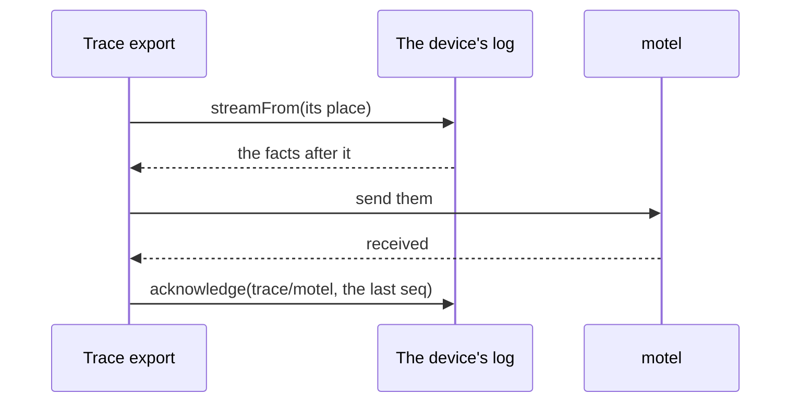
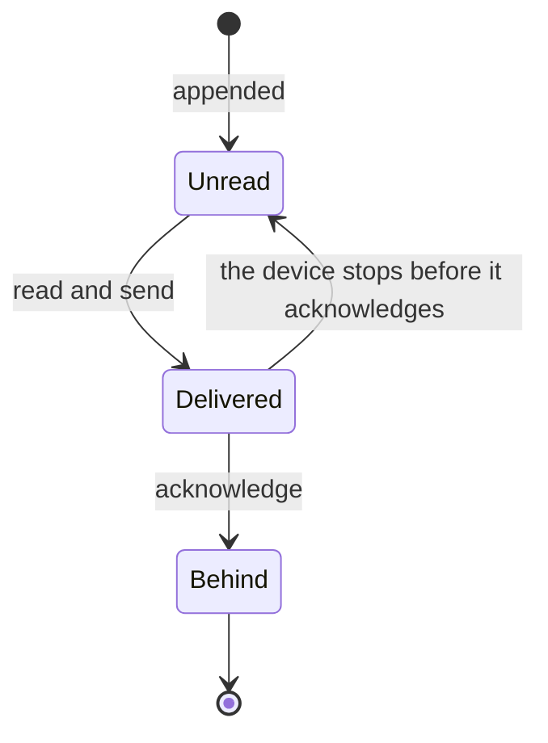

import Exercise from '../../../../../components/Exercise.astro'
import ReadNext from '../../../../../components/ReadNext.astro'
import ReadersWidget from '../../../../../components/ReadersWidget.astro'
import Term from '../../../../../components/Term.astro'
import Terms from '../../../../../components/Terms.astro'
import Readers from '../../../../../partials/log-store/readers.mdx'

## Recall first

Why can a device send the same changeset twice without harm?

Every fact keeps its `tx`, and a log store ignores a fact whose `tx` it
already holds.

What does the clock do when it receives a tx from slightly ahead?

It moves up to it, so the next mint is above that `tx`.

## The idea

**Each reader of a log reads on from its own place, and moves that place only
after it has delivered what it read.**

A device's log is not only written; things on the device read it. The read
models turn its facts into what the screens show. Trace export turns them into
traces and sends those to a trace viewer, such as motel. Each reads at its own
pace, so each keeps its own place: the position of the last fact it has
dealt with. One round of a reader that sends facts on:

For one reader, a fact in the log is in one of three states. A crash before
the acknowledgement sends the facts again; nothing is lost:

### Try it

<ReadersWidget />

What is simplified: the real trace export sends spans it builds from the
workflow facts it reads, not the facts themselves; how it reads and
acknowledges is the same. A test plays every action on a real log store with
the real projector and the real list commands, stops and opens the device
again for each crash, and checks the log, both places, the title and what the
sink received (`apps/docs/src/lib/readers.integration.test.ts`).

### What you saw

1. **Each reader has its own place.** The read models could be ahead of trace
   export, or behind it; neither waits for the other.
2. **A stop after sending only sends again.** The place had not moved, so the
   next round read the same facts; their `tx` is the same, so motel can tell.
3. **Acknowledging first loses facts.** The place moved past facts motel never
   got, and nothing told. The log still had every one: acknowledging never
   removes a fact.

### The words

<Terms>
  <Term term="Consumer" label="Its two calls" formula={"acknowledge:  («consumer», seq) => its place, after it delivered\nacknowledged: («consumer») => its place, or null"} later={['trace sink']} />
  <Term term="Acknowledged cursor" label="Moves" formula="deliver, then move the «acknowledged cursor» to the last seq delivered" />
</Terms>

### The rule

<Readers />

## What the gate showed

[P10 Trace projection][P10] checked that a sink that refuses a send leaves the trace cursor
where it was, and that a disabled trace cursor, enabled again, exports the
whole backlog ("failed send keeps the cursor", "disabled trace cursor keeps
the backlog"). [P04 Log store conformance][P04]'s "acknowledged cursor" check, which reads a place
back and reads on from it, replaced "compaction horizon" on 2026-11-11 ([D223 Each reader keeps its own place][D223])
and runs when the guide is accepted.

## Your turn

Exercise 03.01: an export that sends to `trace/motel` acknowledges before it
sends. The first round crashes while sending, and the facts never reach the
sink.

<Exercise pattern="log-store" id="03.01" />

## Check yourself

The read models' place is 40 and trace export's is 12. Which facts does trace export read next?

The facts after position 12, in log order, whatever the read models have done.

What goes wrong when a reader acknowledges before it delivers?

A crash in between moves its place past facts it never delivered, and nothing
tells.

Why is a crash between delivering and acknowledging harmless?

The place has not moved, so the next round delivers the same facts again with
the same `tx`, and the receiver can tell it already has them.

## Read next

<ReadNext source={frontmatter.source} />

{/* References: written by pnpm refs fix; do not edit by hand. */}

[D223]: ../../../../../../../../docs/plan/bootstrap/02-decision-log.md#d223
[P04]: ../../../../../../../../docs/plan/bootstrap/06-qualification-gates.md#p04
[P10]: ../../../../../../../../docs/plan/bootstrap/06-qualification-gates.md#p10
