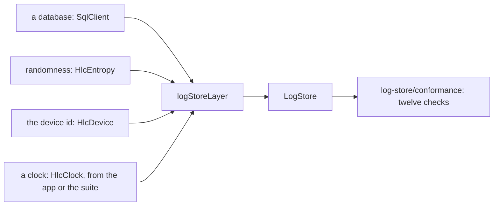

import Exercise from '../../../../../components/Exercise.astro'
import ReadNext from '../../../../../components/ReadNext.astro'
import Sample from '../../../../../components/Sample.astro'
import StoreWidget from '../../../../../components/StoreWidget.astro'
import Term from '../../../../../components/Term.astro'
import Terms from '../../../../../components/Terms.astro'
import StoreImplementation from '../../../../../partials/log-store/store.mdx'

## Recall first

A reader acknowledged position 12. What does it read after a restart?

The facts after 12, in log order: `acknowledged` gives 12 back, and `streamFrom(12)` reads on.

Why is the tx minted once, not on every send?

It is the fact's identity, so a resend must carry the same `tx`.

## The idea

**One log store, written once, runs on every database the stack uses; a store
is a database put under it, and it is done when the suite says so.**

The earlier lessons used one contract: mint, receive, append, stream,
acknowledge. It is written once, against Effect's `SqlClient`; a store
gives it a database and two small pieces, and whoever runs it gives the clock:

### Try it

<StoreWidget />

What is simplified: Node can host four of the six databases, so the widget
runs those here and shows the gate's result for op-sqlite and sqlite-wasm. A
test runs the real suite on each of the four and checks it fails exactly what
the widget says (`apps/docs/src/lib/store-layers.integration.test.ts`).

### What you saw

1. **A missing piece is a compile error.** The `R` slot names what is still
   needed ([idea 7](/guides/before-you-start/#7-layers)).
2. **Changing the database is one line;** the rest of the store is the same.
3. **Passing the compiler is not passing the suite.** In memory, every check
   passed but `hlc reboot`: a restart forgot the saved clock.

### The words

<Terms>
  <Term term="Contract" label="Here" formula="«contract» = the LogStore service and its types" />
  <Term term="Layer" label="Here" formula={"logStoreLayer: needs SqlClient, HlcEntropy, HlcDevice, HlcClock\na store = logStoreLayer with a database and two pieces"} />
  <Term term="Suite" label="Here" formula="log-store/conformance: (a store) => twelve checks, each PASS or FAIL" later={['positive control', 'gate']} />
</Terms>

### The rule

<StoreImplementation />

## What the gate showed

[P04 Log store conformance][P04] ran the same suite against sqlite-node, PGlite, op-sqlite on
the iOS simulator and the Android emulator, and sqlite-wasm with OPFS on the
web, and every check passed on every store. That is the claim that lets the
rest of the stack treat them as one.

## Your turn

Exercise 04.01: `logStoreIn` builds a log store from its parts, and the suite
runs against it. One check fails.

<Exercise pattern="log-store" id="04.01" />

## Check yourself

What does a new store add, and what does it share with the others?

It adds a `SqlClient` Layer; it shares `LogStore` and the suite.

Why is an in-memory database not a log store?

Nothing survives a restart, so the clock and the log would reset.

Where do the checks of a store that needs a device run?

In the gate's probe on devices; `verify` typechecks and lints it.

## Read next

<ReadNext source={frontmatter.source} />

{/* References: written by pnpm refs fix; do not edit by hand. */}

[P04]: ../../../../../../../../docs/plan/bootstrap/06-qualification-gates.md#p04
