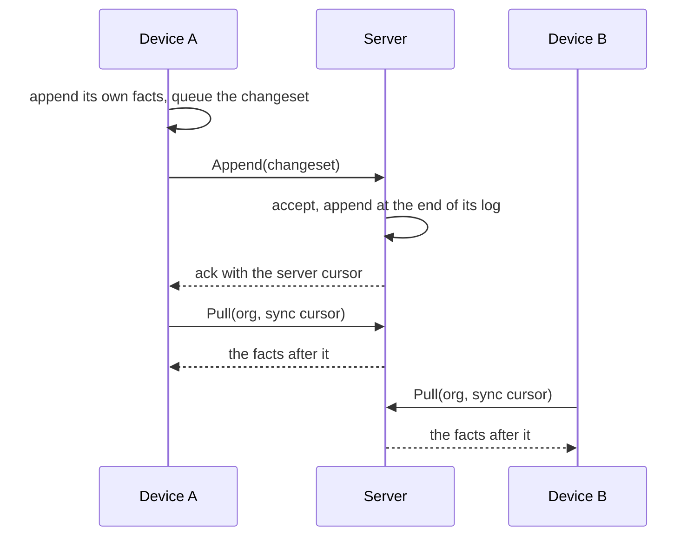

{/* One home (D221): the concepts page and the lessons embed this section; edit it here only. */}

import Sample from '../../components/Sample.astro'

An organization's log has a copy on every device that works with it, and one
on the server ([D103 Nodes and authority][D103], [D217 Who holds the log comes first][D217]). Each copy is a log store with the same contract;
what sets the server's apart is that it holds authority.

- A **device** writes: a command's facts go into its own log at once, and the
  changeset waits in its outbox. It also reads: it pulls the server's facts
  after its sync cursor and appends them at the end of its own log.
- The **server** accepts or rejects each changeset, appends the accepted ones
  at the end of its log, which makes that log the order every device follows,
  and keeps every fact for good: its log is the audit trail and is never
  compacted.

Two devices that take turns on the same entity only append: each fact has its
own `tx`, so nothing collides in the store, and which value counts is decided
by the clock and the attribute's conflict policy, not by who wrote last to the
server. A workflow run's steps are kept as one history by its journal
([ADR-0036 The journal is the fence][ADR-0036]); that belongs to the workflow guide. How the server
accepts a changeset, and how sync filters what a device may see, belong to
the changesets and access guides.

<Sample path="libs/sync/client/src/client.ts" region="pull" />

{/* References: written by pnpm refs fix; do not edit by hand. */}

[ADR-0036]: ../../../../../docs/adr/0036-the-journal-is-the-fence.md
[D103]: ../../../../../docs/plan/bootstrap/02-decision-log.md#d103
[D217]: ../../../../../docs/plan/bootstrap/02-decision-log.md#d217
