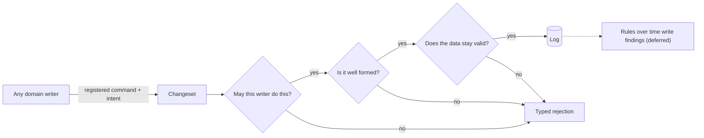

# ADR-0035: Accepting a change

Summary: Authority accepts every change by asking may this writer do this, is it well formed, and does the data stay valid; each check is declared once, runs early on the device and with authority, and has a positive control.

Status: Proposed, unverified

Date: 2026-10-09

Qualifying gate: [P09 Sync][P09] extended with "a changeset that breaks an acceptance rule, or writes outside its
command's declared writes, is rejected with a typed error", built with [I69 Accept checks every change][I69].

Related: [D124 One checkpoint][D124], [D125 Acceptance rules][D125], [D126 No worse][D126], [D127 Registered commands][D127], [D128 Rules over time][D128], [D36' Shared commands, as built][D36']. [ADR-0016 Commands, server validation and rejection][ADR-0016] (commands, server validation and rejection, which
this corrects), [ADR-0011 Log store pattern, read models, compaction and analytics][ADR-0011] (the catalog), [ADR-0032 What ViViEfs is about and its foundation concepts][ADR-0032] (foundation concepts), [ADR-0034 Origin trust][ADR-0034] (origin trust, the origin
of a finding). Opened by [I50 Contracts checked as data or by commands][I50]; [I69 Accept checks every change][I69] (build), [I54 Trust, encryption and who may sign in][I54] and [I16 Roles in use, invitations and self-service membership][I16] (access decisions), [I66 Attribute value types and the typed reference read model][I66] (value Schemas), [I68 Uniqueness as an acceptance rule][I68]
(uniqueness), [I70 Research: access from membership to enterprise][I70] (research on access).

## Problem

vivief's `Contract` is one concept across its whole platform: a declared
constraint that is "simultaneously spec, test, and runtime guard", stored as
datoms and checked by its dispatcher on every effect, whatever handler
produced it, with violations recorded as datoms. ViViEfs said its server
revalidates every changeset, invariants included ([D36 Shared commands][D36]). Reading the code for
[I50 Contracts checked as data or by commands][I50] found that the server does not re-execute the command ([ADR-0016 Commands, server validation and rejection][ADR-0016] Observed)
and checks only structure: membership, actor, changeset manifest, organization, catalog,
files, lease and write-once. A rule that lives in a command, such as
`renameList` refusing a blank title, runs only on the device, so a crafted or
buggy client commits a blank title and the server accepts it. And [I49 Projection: one concept or several patterns][I49] made
writers that are not screens normal: enriching implementations and agents.

## Design

**One checkpoint ([D124 One checkpoint][D124]).** Authority accepts or rejects every change by asking
three questions in order:

| Question | What answers it | Owner |
| --- | --- | --- |
| May this writer do this? | An access decision: membership, `authority: 'server'`, a command's declared writes, later roles | [I54 Trust, encryption and who may sign in][I54], [I16 Roles in use, invitations and self-service membership][I16] |
| Is it well formed? | The structural checks accept runs today | the changesets pattern, the sync server |
| Does the data stay valid? | Acceptance rules, judged no worse | the changesets pattern |

Each check is declared once, runs early on the device for feedback and with
authority on accept as the guard, and has a positive control in a suite.
Enforcement follows trust: no writer checks itself. A rule that names the
writer ("the reviewer is not the author") is an access decision; a rule about
the data alone ("a title is not blank") is an acceptance rule.

**Acceptance rules ([D125 Acceptance rules][D125]).** Code declared beside the catalog: the value
Schema ([D121 Attribute value types][D121]), uniqueness ([D122 External identifiers][D122]), required attributes, allowed transitions of
a value, and entity rules written against a read model so any `node` could
run them ([D105 What must stay possible][D105] (2)). Commands call the same rules. They are a concept of the
changesets pattern, checked by `changesets/acceptance`; a rule without a
positive control fails `verify`. A warning rule is deferred.

**No worse ([D126 No worse][D126]).** A changeset is rejected when it breaks a rule for an
entity where the rule held before it, or for an entity it creates. Data from
before a rule shipped stays editable and is listed as findings.

**Registered commands ([D127 Registered commands][D127]).** Every domain writer (screens, agents,
enriching activities, the operator) uses a command, registered with a name, an
intent Schema, a version name and its declared writes. Accept rejects an
unknown command or a write outside its set. The workflow engine's journal is
the one exception, checked by the durable-workflow pattern's own lease and
write-once rules. Re-running a command on accept is deferred.

**Rules over time ([D128 Rules over time][D128]).** A rule broken by nothing happening is a workflow
with a durable clock writing a finding whose origin is the rule; deferred
until a consumer app has one.

From vivief: the placement and spec, test and guard at once are adopted;
contracts as datoms ([D118 What a datom needs from storage][D118]), the contract lifecycle and the closed set of six
sub-types are not; aggregation is a projection or an enriching implementation
([D111 Faster and enriching implementations][D111]); the in-flight validation point waits with in-flight freshness ([D109 Frame and frame subscription][D109]).

**A direction, not a decision.** Access could become a pattern whose
reference implementation is today's code and whose later implementations
(roles, relations as datoms in the style of Zanzibar, Cedar policies) answer
the same request, the subject, action, resource and context of the OpenID
AuthZEN Authorization API. [I70 Research: access from membership to enterprise][I70] researches it and [I54 Trust, encryption and who may sign in][I54] decides it.

Revisit when a consumer app needs a rule that warns, a rule over time, or
proof that a changeset is exactly what its command makes.

## Trade-offs

- **Re-running the command on accept** proves a changeset is what the named
  code makes, as durable execution's replay does, but it misses every writer
  that is not a command, needs the intent stored (never renamed, erasable) and
  every command version shipped until drained. Deferred ([D127 Registered commands][D127]).
- **Rules as datoms** (vivief) change without a release; here a rule ships
  with a release and its history is git and the decision log ([D118 What a datom needs from storage][D118]).
- **Strict rules on old data** freeze every entity a new rule catches; no
  worse leaves them editable and visible as findings.
- **Commands for screens only** would leave the envelope's `command` a free
  label and request rules without a home.
- **Out-of-scope items ([D100 Out of scope means not yet][D100], [I57 Out-of-scope items in an ADR's trade-offs][I57]).** Rules are written against a read model
  so any `node` holding authority can run them ([D105 What must stay possible][D105] (2)); with several `node`s
  an access check must not read permissions older than the change it guards
  (Zanzibar's new enemy problem; noted on [I60 Server-independent mode][I60]).

## Failure-handling

- A rule that breaks is a typed rejection of the whole changeset; the device
  rebuilds from confirmed data and reapplies its outbox, as today ([ADR-0016 Commands, server validation and rejection][ADR-0016]).
- A rule without a positive control fails `verify`.
- No gate checks this record yet; it is intent until [I69 Accept checks every change][I69] extends [P09 Sync][P09].

## Outcome

### Expected

A changeset that breaks an acceptance rule, comes from an unknown command, or
writes outside its command's declared writes is rejected with a typed error,
on every `node` that runs the rules; the blank-title changeset accepted today
is rejected.

### Observed

Not yet run.

<!-- References: written by pnpm refs fix; do not edit by hand. -->

[ADR-0011]: 0011-log-store-pattern.md
[ADR-0016]: 0016-commands-and-server-validation.md
[ADR-0032]: 0032-what-viviefs-is-about.md
[ADR-0034]: 0034-origin-trust.md
[D100]: ../plan/bootstrap/02-decision-log.md#d100
[D105]: ../plan/bootstrap/02-decision-log.md#d105
[D109]: ../plan/bootstrap/02-decision-log.md#d109
[D111]: ../plan/bootstrap/02-decision-log.md#d111
[D118]: ../plan/bootstrap/02-decision-log.md#d118
[D121]: ../plan/bootstrap/02-decision-log.md#d121
[D122]: ../plan/bootstrap/02-decision-log.md#d122
[D124]: ../plan/bootstrap/02-decision-log.md#d124
[D125]: ../plan/bootstrap/02-decision-log.md#d125
[D126]: ../plan/bootstrap/02-decision-log.md#d126
[D127]: ../plan/bootstrap/02-decision-log.md#d127
[D128]: ../plan/bootstrap/02-decision-log.md#d128
[D36]: ../plan/bootstrap/02-decision-log.md#d36
[D36']: ../plan/bootstrap/02-decision-log.md#d36p
[I16]: ../issues/0016-roles-and-self-service-membership.md
[I49]: ../issues/0049-projection-one-concept-or-several-patterns.md
[I50]: ../issues/0050-contracts-checked-as-data-or-by-commands.md
[I54]: ../issues/0054-trust-encryption-and-who-may-sign-in.md
[I57]: ../issues/0057-out-of-scope-items-in-adr-trade-offs.md
[I60]: ../issues/0060-server-independent-mode.md
[I66]: ../issues/0066-attribute-value-types.md
[I68]: ../issues/0068-uniqueness-as-an-acceptance-rule.md
[I69]: ../issues/0069-accept-checks-every-change.md
[I70]: ../issues/0070-research-access-from-membership-to-enterprise.md
[P09]: ../plan/bootstrap/06-qualification-gates.md#p09
