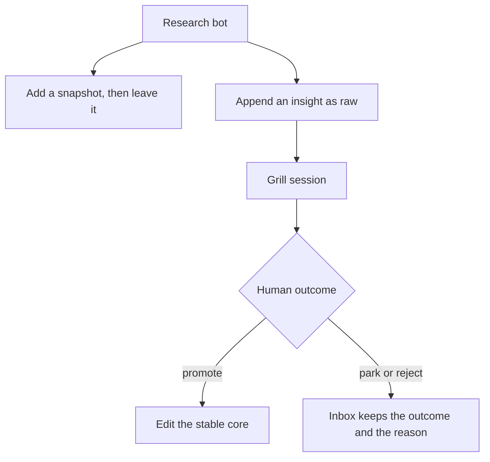
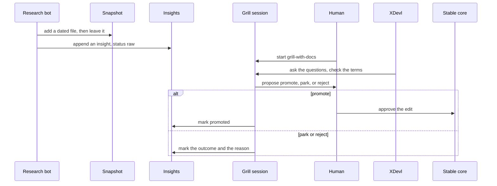
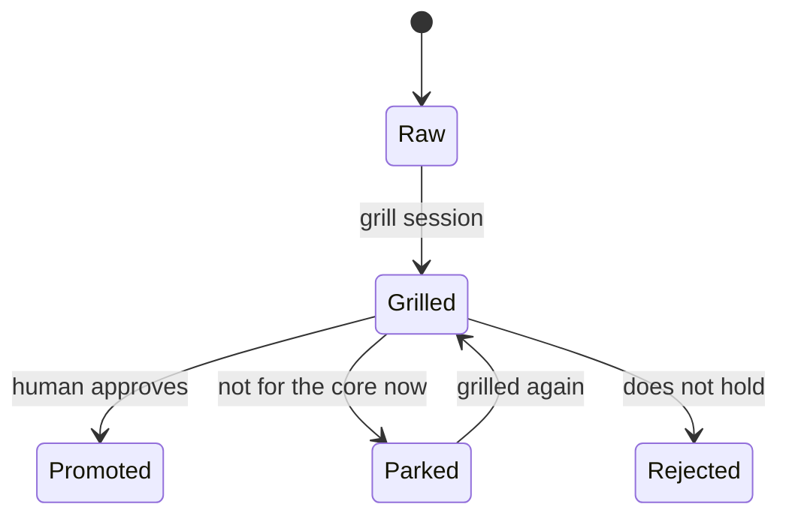
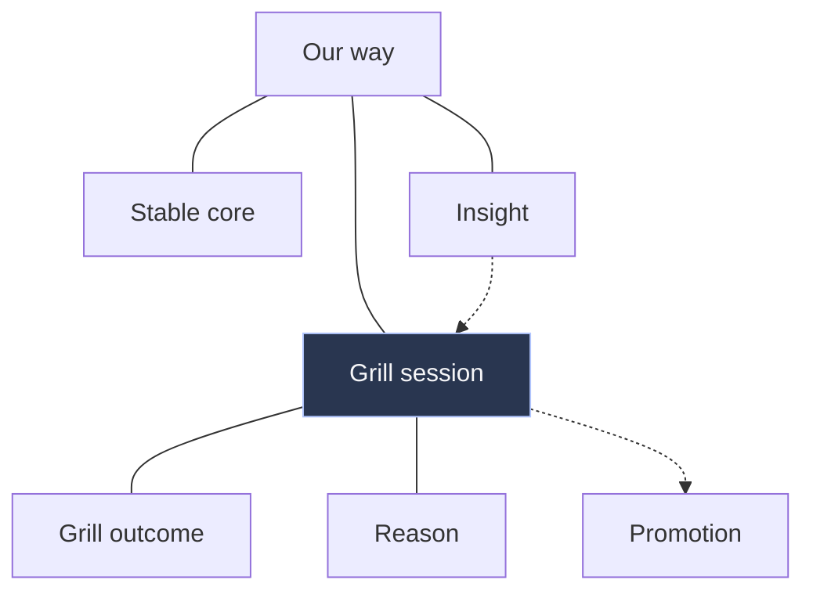

# XDevl

Living account of how Piet, XDevl and the Research bot develop software by
giving the human, the LLM and the system each the work it is strongest at.
This page is the stable core.

**Status: proposed, awaiting the first grill session.** The practices below
are a draft from the two snapshots. Nothing in them is settled.

A snapshot stays as written. A living page changes only in the way
[How to maintain](HOW-TO-MAINTAIN.md) describes. A guide's claim comes from
a gate ([ADR-0026](../../adr/0026-verify-qualify-teach.md),
[D68](../../plan/bootstrap/02-decision-log.md#d68)). Terms are in the
[XDevl glossary](GLOSSARY.md). App creation, Pattern and Guide keep their
meanings in the [repository glossary](../../../GLOSSARY.md).

In the sentences below, the EARS words "THE SYSTEM" mean our way of
developing. They do not mean the glossary term System.

## The loop

The Research bot files what it read. A grill session, with Piet and XDevl,
is the only way into the stable core. The human approves a promotion.

## One cycle

## An insight's life

Whether a park returns, and whether a reject ends the insight, is question 4
in the [grill log](grill-log.md). The diagram shows the recommendation.

## The map

Focus: Grill session. Solid lines are grouping. Dashed arrows are the
sequence. Siblings (Stable core, Insight) meet through their parent, Our
way. Insight is also the previous step. Promotion is the next step on the
promote path. Park and reject are on the state diagram.

App creation, as the repository glossary defines it, is the wider term this
area sits inside. Pattern and Guide are not drawn here. Question 6 asks
whether they should be.

The same map, with a second example for the three roles, is the
[concept map](concept-map.html). Open that file in a browser. The docs site
serves it too.

## Roles

- **Human.** Piet approves a promotion and answers a grill session.
- **LLM.** The Research bot files snapshots and insights. XDevl grills.
  A coding agent edits the repository under the core.
- **System.** Verify, the docs site, and the skills hold the files and the
  checks. They do not decide a promotion.

## Proposed practices

Each sentence uses glossary terms. Who verifies it, and the evidence label,
sit under the sentence. The figures stay in the [inbox](insights.md).

### C1 Short specific rules a human wrote

WHEN an LLM is pointed at instructions, THE SYSTEM SHALL limit those
instructions to short specific rules a human wrote.

Who verifies: the human who approves the instruction file.
Evidence label: verified, via [N35](insights.md#n35).

### C2 A term and plain English count the same for an LLM

WHEN a practice names a glossary term, THE SYSTEM SHALL treat that term and
the same meaning in plain English as equal for the LLM, until a measurement
in this area shows a difference.

Who verifies: no measurement has been run. [N38](insights.md#n38) is the
check the snapshot suggests.
Evidence label: verified for the equal-until-measured reading
([N27](insights.md#n27)). The measurement is unlabelled.

### C3 A human reviews a glossary an LLM wrote

WHEN an LLM writes a glossary entry, THE SYSTEM SHALL leave that entry
unused until a human has reviewed it.

Who verifies: the human's review.
Evidence label: verified, via [N28](insights.md#n28).

### C4 A human replaces an ambiguous word first

WHEN a statement still has an ambiguous word, THE SYSTEM SHALL have a human
replace that word before the statement is promoted, and before an LLM is
asked to rely on it.

Who verifies: the human in the grill session.
Evidence label: verified, via [N26](insights.md#n26), [N33](insights.md#n33)
and [N34](insights.md#n34).

### C5 A human writes the tests that judge a change

WHEN an LLM changes code, THE SYSTEM SHALL judge that change with tests a
human wrote.

Who verifies: the human who owns those tests. This area has not run the
check.
Evidence label: X chatter ([N10](insights.md#n10), [N15](insights.md#n15))
and an unlabelled candidate ([N21](insights.md#n21)). Weaker than C1-C4.

### C6 Planning, coding, fetching and review are different roles

WHEN work is split across LLMs, THE SYSTEM SHALL keep planning, coding and
fetching on separate choices, and SHALL take the review from a different
model family than the coding.

Who verifies: no run in this area yet.
Evidence label: unlabelled candidate, via [N19](insights.md#n19).

### C7 One short AGENTS.md

WHEN more than one tool reads project instructions, THE SYSTEM SHALL point
those tools at one short AGENTS.md.

Who verifies: a human, by there being one such file. This repository has
[AGENTS.md](../../../AGENTS.md).
Evidence label: unlabelled candidate ([N08](insights.md#n08),
[N22](insights.md#n22)), with [N35](insights.md#n35) on keeping it short.

## Where to read next

- [Glossary](GLOSSARY.md)
- [Insights](insights.md), all raw
- [Grill log](grill-log.md), including the questions for the first session
- [How to maintain](HOW-TO-MAINTAIN.md)
- [Snapshot, 2026-10-08, coding models on X](snapshots/2026-10-08-coding-llms-on-x.md)
- [Snapshot, 2026-10-09, glossary-defined English](snapshots/2026-10-09-glossary-defined-english.md)
