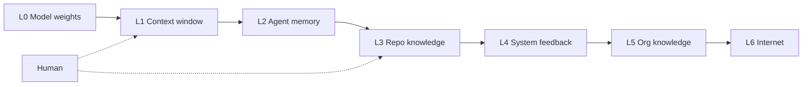
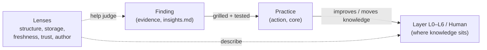

# XDevl

Area map for how Piet, XDevl and the Research bot develop software by giving
the human, the LLM and the system each the work it is strongest at.

This directory is an area ([D215 Issue and Area defined](../../plan/bootstrap/02-decision-log.md#d215)). It holds
living pages and dated snapshots. Decisions live in the
[decision log](../../plan/bootstrap/02-decision-log.md). Vocabulary lives in
the [repository glossary](../../../GLOSSARY.md). The first grill session, on
2026-10-21, is [D209 Knowledge layers by distance](../../plan/bootstrap/02-decision-log.md#d209) through
[D215 Issue and Area defined](../../plan/bootstrap/02-decision-log.md#d215). Questions still open are
[I102 XDevl grill: open questions](../../issues/0102-xdevl-grill-open-questions.md).

A snapshot stays as written. A guide's claim comes from a gate
([ADR-0026 Verify - Qualify - Teach](../../adr/0026-verify-qualify-teach.md),
[D68 Research records](../../plan/bootstrap/02-decision-log.md#d68)). In the sentences below, the EARS words
"THE SYSTEM" mean our way of developing. They do not mean the glossary term
System.

## Knowledge layers

Distance from the model's working context is the main axis
([D209 Knowledge layers by distance](../../plan/bootstrap/02-decision-log.md#d209)). The README opens here, and every
practice and every finding carries a layer tag
([D210 Layers as the backbone](../../plan/bootstrap/02-decision-log.md#d210)).

L0 is model weights. L1 is the context window. L2 is agent memory across
sessions. L3 is repo knowledge. L4 is system feedback. L5 is org knowledge.
L6 is the internet. The Human is tacit knowledge, reaching the model through
grilling, the glossary and written decisions. The dashed lines are that
reach, into the context window and into repo knowledge.

Lenses describe every layer, and help judge a finding: structure, storage,
freshness, trust, and who writes it.

## Findings, practices, layers

A knowledge layer is where knowledge sits. A lens describes it. A practice
improves a layer or moves knowledge between layers. A finding is evidence in
the [inbox](insights.md) that a practice works, and it becomes a practice
once grilled and tested ([D211 Layers, lenses, practices, findings](../../plan/bootstrap/02-decision-log.md#d211)).

## Practices

C1-C4 are in the core. C5-C7 are parked until this repository tries them
([D212 First core practices](../../plan/bootstrap/02-decision-log.md#d212)). The sentences are the ones drafted
before the session. The session's shorter labels named other subjects, so
each practice is tagged from its sentence. Prices and benchmark scores stay
in the snapshots ([D213 Numbers stay in snapshots](../../plan/bootstrap/02-decision-log.md#d213)). The newest
snapshot is
[2026-10-09, glossary-defined English](snapshots/2026-10-09-glossary-defined-english.md).

Who verifies a sentence, and its evidence label, sit under the sentence.

### L3 Repo knowledge

#### C1 Short specific rules a human wrote

Layer: L3.

WHEN an LLM is pointed at instructions, THE SYSTEM SHALL limit those
instructions to short specific rules a human wrote.

Who verifies: the human who approves the instruction file.
Evidence label: verified, via [N35](insights.md#n35).

#### C2 A term and plain English count the same for an LLM

Layer: L3.

WHEN a practice names a glossary term, THE SYSTEM SHALL treat that term and
the same meaning in plain English as equal for the LLM, until a measurement
in this area shows a difference.

Who verifies: no measurement has been run. [N38](insights.md#n38) is the
check the snapshot suggests.
Evidence label: verified for the equal-until-measured reading
([N27](insights.md#n27)). The measurement is unlabelled.

#### C3 A human reviews a glossary an LLM wrote

Layer: L3.

WHEN an LLM writes a glossary entry, THE SYSTEM SHALL leave that entry
unused until a human has reviewed it.

Who verifies: the human's review.
Evidence label: verified, via [N28](insights.md#n28).

### Human

#### C4 A human replaces an ambiguous word first

Layer: Human.

WHEN a statement still has an ambiguous word, THE SYSTEM SHALL have a human
replace that word before the statement is promoted, and before an LLM is
asked to rely on it.

Who verifies: the human in the grill session.
Evidence label: verified, via [N26](insights.md#n26), [N33](insights.md#n33)
and [N34](insights.md#n34).

### Parked

Parked practices stay visible. They are not in the core.

#### C5 A human writes the tests that judge a change

Layer: L4. Parked.

WHEN an LLM changes code, THE SYSTEM SHALL judge that change with tests a
human wrote.

Who verifies: the human who owns those tests. This area has not run the
check.
Evidence label: X chatter ([N10](insights.md#n10), [N15](insights.md#n15))
and an unlabelled candidate ([N21](insights.md#n21)). Weaker than C1-C4.

#### C6 Planning, coding, fetching and review are different roles

Layer: L0, L1. Parked.

WHEN work is split across LLMs, THE SYSTEM SHALL keep planning, coding and
fetching on separate choices, and SHALL take the review from a different
model family than the coding.

Who verifies: no run in this area yet.
Evidence label: unlabelled candidate, via [N19](insights.md#n19).

#### C7 One short AGENTS.md

Layer: L3. Parked.

WHEN more than one tool reads project instructions, THE SYSTEM SHALL point
those tools at one short AGENTS.md.

Who verifies: a human, by there being one such file. This repository has
[AGENTS.md](../../../AGENTS.md).
Evidence label: unlabelled candidate ([N08](insights.md#n08),
[N22](insights.md#n22)), with [N35](insights.md#n35) on keeping it short.

## Where to read next

- [Repository glossary](../../../GLOSSARY.md)
- [Decision log, D209-D215](../../plan/bootstrap/02-decision-log.md#d209-d215)
- [I102 XDevl grill: open questions](../../issues/0102-xdevl-grill-open-questions.md)
- [Insights](insights.md)
- [How to maintain](HOW-TO-MAINTAIN.md)
- [Concept map](concept-map.html)
- [Newest snapshot, 2026-10-09, glossary-defined English](snapshots/2026-10-09-glossary-defined-english.md)
- [Snapshot, 2026-10-08, coding models on X](snapshots/2026-10-08-coding-llms-on-x.md), which holds the prices and benchmark scores
